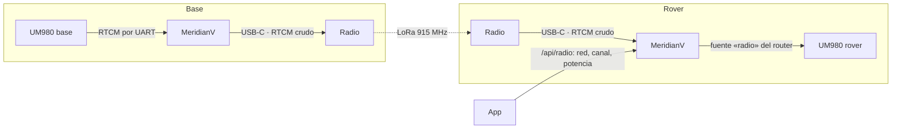

# Módulo de radio LoRa

El radio del MeridianV **no va dentro del equipo**: es un aparato aparte, que se vende por
separado, con su propio ESP32 y **su propia pila**. Se conecta con un cable USB-C al puerto
USB-C del MeridianV y por ese cable entran y salen las correcciones. Decisiones del
propietario del 02-10-2026 (radio aparte) y del 12-10-2026 (enlace por USB-C en lugar del
Wi-Fi del MeridianV y sin alta por Bluetooth).

| | |
| --- | --- |
| Placa | ESP32-S3 + **Ebyte E22-900M30S** (SX1262 + amplificador, hasta 30 dBm = 1 W; versión SPI «M»). Elegida por alcance frente a la Heltec LoRa 32 V3 (≈22 dBm). El firmware la limita a **27 dBm** (IFT-008-2015) |
| Banda | **915 MHz** (902–928 MHz, libre en México) |
| Papel | **Los dos sentidos**: si su MeridianV está en base, transmite el RTCM; si está en rover, lo recibe y se lo entrega |
| Enlace con el MeridianV | **USB-C**: el radio es el anfitrión USB y el MeridianV el dispositivo CDC de siempre. Protocolo en [USB_LINK.md](USB_LINK.md) |
| Configuración | Desde las apps, por `/api/radio` del MeridianV, que la reenvía por el cable. El radio no usa Wi-Fi ni Bluetooth |

## Por el aire (`firmware/esp32/lib/protocol/src/radio_air.h`)

- **LoRa SF7, 500 kHz, CR 4/5**: ≈21.9 kbit/s brutos. Un paquete de 255 bytes ocupa el aire
  ≈100 ms, así que caben ≈2.5 kB/s. Un RTCM MSM4 de cuatro constelaciones a 1 Hz son
  1–1.5 kB/s: cabe. **MSM7 no cabe**: la base que transmita por radio debe ir en MSM4.
- **13 canales** de 903 a 927 MHz cada 2 MHz; por omisión el 6 (915 MHz). Base y rover en el
  mismo canal.
- **Red** (0–255) en cada paquete: dos bases en el mismo canal no se mezclan; el rover solo
  acepta la suya.
- **Paquete**: `0xA7`, red, secuencia de 16 bits y hasta 251 bytes del flujo RTCM. El rover
  concatena en orden y su parser RTCM3 (CRC-24Q, con reloj: `feedAt`) saca las tramas; un
  paquete perdido solo estropea las que lo cruzaban, y al ver un salto de secuencia se
  reinicia el parser.
- La base espera 25 ms tras el último byte antes de mandar un paquete a medio llenar: junta
  las tramas de una época en menos paquetes.
- **Potencia: 27 dBm de tope y por omisión** en el firmware del radio
  (`firmware/radio/src/radio_config.h`). La IFT-008-2015 (§4.3, modulación digital) limita la
  densidad a 8 dBm en 3 kHz: 30 dBm en ~500 kHz dan ≈7.8 dBm/3 kHz, sin margen para la
  tolerancia de +1 dB del amplificador; 27 dBm dejan 3 dB (mismo criterio que el MeridianVI,
  `MeridianVI/hardware/meridian-vi/research/spec.md` §11.1). La norma tampoco admite controles
  que pasen el límite: un valor mayor que llegue al radio se recorta a 27 y se avisa. El
  SX1262 a +19 dBm da ≈27 dBm a la salida de la E22 (ganancia nominal de 8 dB, por medir).
  `radio_air.h` conserva `kMaxOutputDbm = 30` como capacidad de la E22; el tope legal es el
  del radio.

**Pendiente antes de vender:** medir el ancho de banda a 6 dB (≥ 500 kHz para contar como
modulación digital, §4.3.3) y la densidad espectral del equipo armado, y homologarlo con sus
antenas (§4.1.4; PIRE ≤ 4 W).

## Entre el radio y el MeridianV

Todo en [USB_LINK.md](USB_LINK.md). En resumen: por el mismo CDC del MeridianV viajan las
órdenes JSON de siempre, el RTCM crudo (con su CRC-24Q) y tramas del enlace (`F5 52`, JSON y
CRC-24Q): saludo con versión, papel, estado cada segundo, configuración con su
confirmación. **El radio no da VBUS** al MeridianV: no se descarga cargándolo y el MeridianV
se puede apagar con el radio puesto.

## En el MeridianV

- `src/usb_channel.cpp`: una tarea lee el CDC y lo separa (consola JSON, RTCM, tramas del
  enlace); todo lo que sale por el USB pasa por un escritor único.
- `src/radio_module.cpp`: detecta el radio por su saludo, le da el papel según el modo del
  receptor, le manda el RTCM de la base y mete el del rover en el router como fuente `radio`.
- `/api/status` → `subsystems.radio`; `/api/radio` (GET estado; POST `network`, `channel`,
  `power_dbm`, que se reenvían al radio con un número `seq` y se confirman con `config_state`).
- Fuente `radio` en `/api/corrections/source`.
- Placa v0.3: cargador en HIZ mientras haya un radio enlazado (USB_LINK.md §9.2).

## Las apps

Ya no hay Bluetooth del radio ni alta Wi-Fi. Con `capabilities.lora_radio` = `false` y
`subsystems.radio.link` = `"usb"`:

1. **Detección**: `GET /api/radio` → `state` = `connected` cuando hay un radio enchufado y
   enlazado (`not_connected` si no). Mostrar `radio_version`, `radio_id`, `air`, `rssi_dbm`,
   `snr_db`, los paquetes y `battery_mv` (null si el radio no la mide).
2. **Configurar**: `POST /api/radio` con lo que cambie (`network` 0–255, `channel` 0–12,
   `power_dbm` 0–27; se admite hasta 30, pero el radio aplica `max_power_dbm`). Respuesta 202
   con `config_seq` y `config_state` = `pending`; sin radio, 409 `radio_not_connected`.
3. **Confirmar**: volver a pedir `GET /api/radio` hasta que `config_state` sea `applied`
   (con los valores nuevos en `network`, `channel` y `power_dbm`; `power_limited` = true si se
   recortó), `rejected` (`config_error` dice por qué) o `not_confirmed` (el radio se
   desconectó antes de contestar).
4. **Fuente**: en rover, elegir `radio` en `/api/corrections/source` (si no hay otra elegida,
   se adopta sola al enlazar). En base no hay nada que elegir: el RTCM sale solo.
5. Con `link` ausente (firmware hasta 0.9.0) sigue el flujo anterior: radio 0.1.x por Wi-Fi y su
   alta por Bluetooth («TresVizo Radio XXXX»).

## En el radio (`firmware/radio/`)

Proyecto de PlatformIO aparte (ESP32-S3, Arduino, RadioLib). Pines de la E22 en
`platformio.ini`, **por confirmar con el cableado real**. El USB-C nativo es el enlace, como
anfitrión; el firmware se carga y la consola se lee por UART0 (puerto «Carga» con puente
USB-UART, ver USB_LINK.md §9). Estado en un LED.

## Estado (12-10-2026)

- **Hecho y compilando**: el firmware 0.2.0 del radio y el lado del MeridianV (Thing Plus y
  v0.3), con pruebas nativas del entramado, del saludo de los dos lados y del HIZ del cargador
  (`python3 tools/firmware_tests/run_native.py`).
- **Sin probar con hardware**: no hay radios todavía.

## Lo que falta

- La placa del radio: requisitos de USB-C y energía en USB_LINK.md §9.
- Probarlo con dos radios en campo: alcance, pérdidas, latencia de la corrección.
- Las apps: el flujo de «Las apps», arriba.
- Medir la ganancia real del amplificador y el consumo a 27 dBm.
