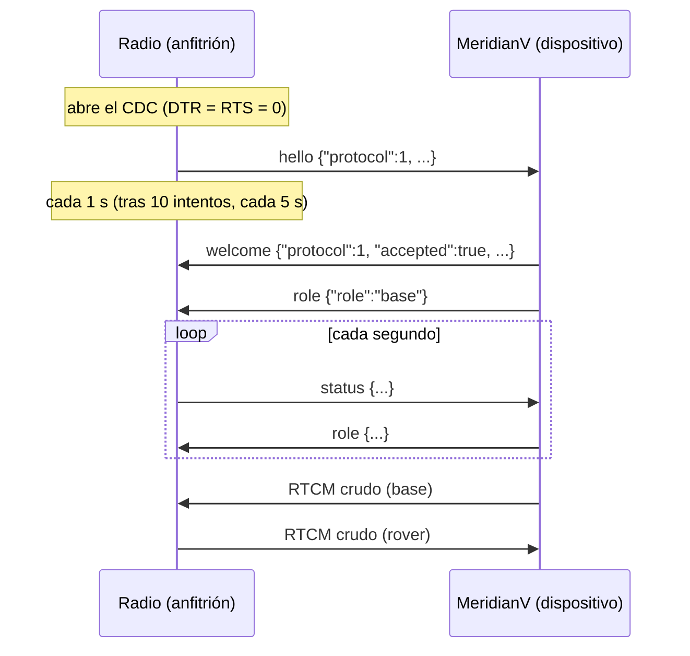

# Enlace USB-C entre el MeridianV y su radio LoRa

El radio LoRa es un **aparato aparte, con su propia pila**, que se conecta con un cable
USB-C al puerto USB-C del MeridianV. Por ese cable entran y salen las correcciones: en base,
el MeridianV le pasa el RTCM al radio y el radio lo transmite; en rover, el radio lo recibe
por el aire y se lo entrega al MeridianV. Decisión del propietario del 12-10-2026; sustituye
al enlace por el Wi-Fi del MeridianV (TCP a `192.168.4.1:2102`, ya retirado) y al alta del
radio por Bluetooth (que queda solo para radios 0.1.x).

**Estado (12-10-2026).** Los dos lados están escritos y compilan: el radio (`firmware/radio`,
0.2.0) y el MeridianV (Thing Plus y v0.3). El entramado, el saludo de los dos lados y el HIZ
del cargador tienen pruebas nativas. **Nada se ha probado con hardware** (§12).

## 1. Papeles USB

| | MeridianV | Radio |
| --- | --- | --- |
| Papel | **Dispositivo** (UFP) | **Anfitrión** (DFP) |
| Periférico | USB-Serial/JTAG del ESP32-S3: CDC-ACM, `303A:1001`, full speed (12 Mbit/s), paquetes de 64 B | USB-OTG del ESP32-S3 en modo anfitrión, PHY interno (GPIO19 D−, GPIO20 D+) |
| Software | El CDC de siempre (`Serial`, la consola JSON por USB) | USB Host Library de ESP-IDF 4.4 y un cliente CDC-ACM propio (`src/usb_cdc_host.cpp`) |
| Hardware | **Sin cambios**: placa v0.3 ya fabricada y Thing Plus (las dos solo tienen Rd en CC) | Por diseñar (§9) |

El MeridianV no necesita modo anfitrión: su puerto sigue siendo el mismo dispositivo CDC por
el que se le hablan órdenes JSON desde la computadora y se le carga el firmware.

## 2. Enumeración y apertura (lo hace el radio)

1. El radio detecta el dispositivo por el pull-up de D+ del MeridianV y la USB Host Library
   lo enumera.
2. El cliente busca en sus descriptores una **interfaz de datos CDC** (clase `0x0A`) con un
   bulk IN y un bulk OUT, y la de comunicaciones ACM (`0x02`/`0x02`). Si no la tiene (un
   teclado, una memoria), lo suelta y espera otro (`refused`).
3. Reclama la interfaz de datos y manda `SET_LINE_CODING` (115200 8N1; el USB-Serial/JTAG no
   usa la velocidad) y `SET_CONTROL_LINE_STATE` con **DTR = 0 y RTS = 0**. RTS no se activa
   nunca: en el USB-Serial/JTAG del ESP32-S3, RTS reinicia el chip (es lo que usa esptool para
   reiniciarlo) y DTR prepara el modo de descarga. DTR = RTS = 0 es como se usa el MeridianV
   desde siempre (`monitor_dtr = 0`, `monitor_rts = 0` en `firmware/esp32/platformio.ini`).
4. Deja siempre una transferencia bulk IN de 512 B en cola (acaba con el primer paquete
   corto: lo que escribe el MeridianV llega enseguida) y saca lo que haya que mandar de un
   anillo de 4 KiB, en transferencias OUT de hasta 1088 B (cabe una trama entera).

El radio **no filtra por VID:PID**: abre cualquier CDC. Lo que haya del otro lado lo decide el
saludo (§4): sin saludo aceptado no transmite ni entrega nada.

## 3. Qué viaja por el cable

Por el mismo CDC van tres cosas, cada una con su forma de reconocerse. No hay un envoltorio
común: así la consola JSON de siempre no cambia para quien conecte una computadora.

| Clase | Empieza por | Acaba | Integridad | Quién la manda |
| --- | --- | --- | --- | --- |
| Línea de texto | un byte de texto (`{` en el JSON) | `\n` | ninguna | Computadora → MeridianV: órdenes. MeridianV → quien sea: respuestas, arranque, avisos |
| Trama RTCM3 | `0xD3`, 6 bits a 0, 10 de longitud | por su longitud | CRC-24Q | MeridianV → radio en base; radio → MeridianV en rover |
| Trama del enlace | `0xF5 0x52` | por su longitud | CRC-24Q | Los dos (§5) |

El RTCM va **crudo**, no dentro de JSON: una línea de la consola admite 1024 bytes y una trama
RTCM3 llega a 1029 (en base64, 1372).

### 3.1 Trama del enlace (`firmware/esp32/lib/protocol/src/radio_usb.h`)

| Byte | Valor |
| --- | --- |
| 0 | `0xF5` |
| 1 | `0x52` (`R`) |
| 2 | Versión del entramado: `0x01` |
| 3 | Tipo (`0x01`–`0x7F`, §5) |
| 4–5 | Longitud de la carga, little-endian, 0–1024 |
| 6… | Carga: JSON en UTF-8 |
| últimos 3 | CRC-24Q (el de RTCM3, polinomio `0x1864CFB`) de los bytes 0 a 5 + N, el más significativo primero |

Trama máxima: 1033 bytes. `0xF5` **nunca aparece en UTF-8**, así que no puede salir de una
línea de texto ni de un JSON, y no es `{` ni `0xD3`. El segundo byte, la versión, el tipo y el
tope de longitud descartan casi toda la basura antes de llegar al CRC.

Reglas para crecer sin romper: un **tipo desconocido** se ignora; una **clave JSON
desconocida**, también. Un cambio incompatible del entramado cambiaría los bytes de sincronía,
no la versión: una trama con versión distinta de 1 no se reconoce (cuenta como basura).

### 3.2 Demultiplexor (los dos lados: `radio_usb::Demux`)

- Entre mensajes se saltan espacios, `\r` y `\n`.
- `0xD3` empieza una RTCM: segundo byte con los 6 bits altos a 0, longitud ≤ 1023 y CRC.
- `0xF5` empieza una trama del enlace: `0x52`, versión 1, tipo válido, longitud ≤ 1024 y CRC.
- Cualquier otro byte de texto empieza una línea, hasta `\n`. Se quitan los `\r`. Hasta 1024
  caracteres: si pasa, se tira y al llegar su `\n` se avisa (la consola contesta 413). Una
  línea a medias durante 5 s se tira (408). Es lo que hacía la consola del MeridianV.
- Un byte que no puede ser texto (controles salvo `\t`, `\r`, `\n`; `0xC0`, `0xC1`,
  `0xF5`–`0xFF`) **corta la línea**: lo anterior se tira y se mira desde ese byte, o desde el
  `0xD3` de antes si lo había (el segundo byte de una RTCM, `0x00`–`0x03`, es justo un
  control). Un JSON con texto cirílico (`0xD3 0x81`…) sigue entero: su `0xD3` va seguido de un
  byte de texto.
- Si una trama binaria falla (cabecera imposible o CRC malo), se salta un byte y se vuelven a
  mirar los que ya había: la basura o un corte cuestan esa trama y nada más.
- Las mismas reglas que el parser RTCM3 del MeridianV (`rtcm3.h`): una trama binaria a medias
  se **abandona en cuanto dentro del búfer se completa otra posterior con CRC correcto**
  (`abandoned`), y se suelta si pasa **1 s sin bytes nuevos** (`expired`).
- Solo se entregan tramas binarias con CRC correcto. Contadores: tramas, RTCM, líneas, CRC
  malos, abandonadas, caducadas, líneas cortadas, largas y a medias, bytes de basura.

**Quien escribe** manda cada trama o línea entera, de una vez y bajo un mismo cerrojo. En el
MeridianV todo sale por `usb_channel::write` (`src/usb_channel.cpp`): respuestas JSON, avisos
de texto, tramas del enlace y RTCM. El demultiplexor aguanta una escritura metida en medio de
otra, pero pierde lo que quede cortado.

En el MeridianV una tarea propia lee el CDC y lo pasa por el demultiplexor; las órdenes JSON
se ejecutan en el bucle principal, de una en una (mientras una espera, la tarea no lee más,
como hacía la consola). **Con un radio enlazado la consola no ejecuta líneas ni contesta 413 o
408**: del otro lado está el radio, que no manda órdenes, y una línea sería un trozo roto.

## 4. Saludo y versiones



- El radio manda `hello` en cuanto abre el CDC y lo repite cada segundo hasta recibir
  `welcome`; tras 10 intentos, cada 5 s (un MeridianV con firmware viejo no lo entiende).
- El MeridianV, al primer `hello` válido, sabe que lo conectado es **un radio TresVizo y no
  una computadora** (una computadora nunca manda `F5 52`): contesta `welcome` y enseguida
  `role`. Cada `hello` nuevo reinicia su estado del enlace aunque creyera estar enlazado.
- **Versión del protocolo**: `hello.protocol` es la más alta que habla el radio y
  `welcome.protocol` la que se usará (≤ la del radio). El radio solo acepta un `welcome` con
  `accepted: true` y una versión que hable (hoy, la 1). Las claves y los tipos nuevos no suben
  la versión; solo un cambio incompatible del juego de mensajes.
- Hasta que se acepta el saludo, el radio **no transmite ni entrega RTCM**: del otro lado
  puede haber cualquier CDC.
- Un MeridianV con firmware sin enlace USB ve el `hello` como basura (puede contestar 400 o
  408 a líneas rotas); el radio nunca recibe `welcome` y se queda callado en el aire.
- Rechazo (`accepted: false`, p. ej. `"error":"unsupported_protocol"`): el radio no vuelve a
  saludar hasta que lo desconecten; su LED parpadea rápido.

## 5. Mensajes

Todos en JSON. Lo desconocido es `null`, nunca 0.

| Tipo | Nombre | Sentido | Cuándo |
| --- | --- | --- | --- |
| `0x01` | `hello` | radio → MeridianV | al abrir el CDC y hasta el `welcome` |
| `0x02` | `role` | MeridianV → radio | tras el `welcome`, al cambiar y **cada segundo** (es su latido) |
| `0x03` | — | — | reservado: era el RTCM envuelto del enlace por Wi-Fi; por USB el RTCM va crudo |
| `0x04` | `status` | radio → MeridianV | enseguida tras el `welcome` y **cada segundo** (es su latido) |
| `0x05` | `config` | MeridianV → radio | cuando una app cambia red, canal o potencia (`/api/radio`) |
| `0x06` | `welcome` | MeridianV → radio | respuesta a cada `hello` |
| `0x07` | `config_ack` | radio → MeridianV | respuesta a cada `config` |

**`hello`**

```json
{"protocol":1,"radio_version":"0.2.0","radio_id":"A0B1C2D3E4F5",
 "hardware":"tresvizo-radio-e22-esp32s3-v1","network":1,"channel":6,
 "power_dbm":27,"max_power_dbm":27,"channels":13}
```

**`welcome`**: `{"protocol":1,"accepted":true,"receiver_version":"0.9.1","hardware_id":"…"}`
o `{"protocol":1,"accepted":false,"error":"unsupported_protocol","message":"…"}`.

**`role`**: `{"role":"base"}`, `"rover"` o `"idle"`. Sigue al modo del MeridianV, como antes.
Lo desconocido vale `idle` (no transmitir).

**`status`**

| Clave | Qué es |
| --- | --- |
| `role` | Papel con el que está configurada la radio |
| `network`, `channel`, `power_dbm`, `max_power_dbm` | Ajustes vigentes; `max_power_dbm` = 27 |
| `rssi_dbm`, `snr_db` | Del último paquete recibido (rover); `null` sin paquetes |
| `packets_sent`, `packets_received`, `packets_lost`, `packets_foreign` | Paquetes del aire (los de otras redes en el mismo canal son `foreign`) |
| `frames_to_air` | Tramas RTCM del MeridianV que entraron al aire (base) |
| `frames_from_air` | Tramas RTCM válidas entregadas al MeridianV (rover) |
| `frames_expired`, `frames_overflow` | Tramas de la base tiradas por viejas (> 2 s) o por cola llena (16) |
| `rtcm_rejected` | Tramas rearmadas del aire con CRC malo (rover) |
| `air` | `transmitting`, `receiving`, `listening`, `idle` o `radio_error` |
| `radio_error_code` | Código de RadioLib si la radio no arrancó |
| `battery_mv` | Tensión de la pila del radio; `null` mientras su placa no la mida |
| `uptime_s`, `usb_rx_dropped`, `usb_tx_dropped` | Diagnóstico del radio y de su USB |

**`config`**: `{"seq":12,"channel":3}`. Solo las claves que cambian (`network` 0–255,
`channel` 0–12, `power_dbm`); `seq` es un número creciente que pone el MeridianV.

**`config_ack`**: `{"seq":12,"ok":true,"network":1,"channel":3,"power_dbm":27,
"max_power_dbm":27}`. Con `"power_limited":true` si pidió más de 27 dBm (se aplica 27; se
admite hasta 30 para no romper a un MeridianV que valide 0–30) y `"saved":false` si no se
pudo guardar en la NVS (vale hasta apagarlo). Si algo no vale: `"ok":false,
"error":"invalid_setting","message":"…"` y el radio no cambia nada. Con el `seq` el MeridianV
sabe que su orden **llegó y se aplicó**: aceptarla (202) no es confirmarla.

**Potencia: 27 dBm de tope y por omisión** (IFT-008-2015 §4.3: ≤ 8 dBm en 3 kHz; 30 dBm en
~500 kHz dan ≈7.8 dBm/3 kHz, sin margen para el +1 dB del amplificador). Ningún mensaje puede
pasarlo (§4.1.5 de la norma). Un radio 0.1.0 con 30 dBm guardados arranca en 27.

**RTCM.** Base: el MeridianV escribe cada trama RTCM que produce su receptor (la misma que va
al caster), solo con un radio enlazado en papel base; el radio la encola (16 tramas), tira la
de más de 2 s y la junta en paquetes del aire. Rover: el radio escribe cada trama que rearma
del aire con CRC correcto; el MeridianV la mete en el router como fuente `radio` solo si le
dio papel rover. Un RTCM que llegue de algo que no es un radio enlazado se ignora.

## 6. Tiempos (`radio_usb.h`)

| Constante | Valor | Para qué |
| --- | --- | --- |
| `kHelloPeriodMs` / `kHelloSlowPeriodMs` | 1 s / 5 s (tras 10) | Saludo sin respuesta |
| `kStatusPeriodMs` | 1 s | `status` del radio |
| `kRolePeriodMs` | 1 s | `role` del MeridianV |
| `kSilenceTimeoutMs` | 3.5 s | Sin latido del otro lado: enlace caído (tres latidos y medio) |
| `kStaleFrameMs` | 1 s | Trama binaria a medias sin bytes nuevos |
| `kLineTimeoutMs` | 5 s | Línea a medias (el 408 de la consola) |
| Cola de la base | 16 tramas, 2 s | RTCM más viejo no le sirve al rover |

## 7. Errores y casos raros

- **Basura, cortes y CRC malos**: el demultiplexor (§3.2). Ni una trama del enlace ni una RTCM
  salen sin CRC correcto.
- **El MeridianV se reinicia o se cuelga**: la ROM y un pánico escriben texto (líneas que el
  radio ignora); al reiniciarse su USB se va y vuelve, y el radio lo ve como un dispositivo
  nuevo: saludo otra vez.
- **El MeridianV deja de leer** (bucle trabado): su USB-Serial/JTAG contesta NAK, el anillo de
  salida del radio se llena y se tiran escrituras (`usb_tx_dropped`); sin `role` 3.5 s, el
  radio da el enlace por caído y deja de transmitir.
- **El radio se reinicia**: al MeridianV le dejan de llegar `status`; a los 3.5 s da el
  enlace por caído; el `hello` nuevo lo vuelve a enlazar.
- **El radio está transmitiendo** (≈100 ms por paquete, hasta ~0.4 s por época): el USB
  sigue recibiendo en el otro núcleo, con 4 KiB de holgura (`usb_rx_dropped` si no alcanza).
- **`config` inválido**: `config_ack` con `ok: false`; el radio conserva sus ajustes.
- **Protocolo distinto**: `welcome` con `accepted: false`; el radio queda callado hasta que
  lo desconecten.

## 8. Desconectar y reconectar

- **Radio**: al irse el dispositivo cancela las transferencias, suelta la interfaz y cierra;
  el papel vuelve a `idle` y la radio se duerme (3 µA); la cola de la base se vacía (no se
  transmite RTCM viejo al volver). Al reconectar: enumeración, `hello`, `welcome`, `role`.
- **MeridianV**: sin `status` 3.5 s da el radio por desconectado: papel `idle`, deja de
  mandarle RTCM, devuelve el cargador a su estado (§9) y `/api/radio` dice `not_connected`. La
  fuente `radio` sigue elegida y vuelve sola al reconectar, como con el Wi-Fi. Si en su lugar
  se enchufa una computadora, la consola JSON funciona como siempre.
- Desde el radio, un reinicio del MeridianV y un cable quitado y vuelto a poner se ven igual.

## 9. Energía

### 9.1 Requisitos para el hardware del radio

1. **El radio no da VBUS al MeridianV** (VBUS a 0 V en ese puerto). No hace falta para los
   datos y darlo trae problemas:
   - El ESP32-S3 no tiene entrada de VBUS: su USB-Serial/JTAG pone el pull-up de D+ con VBUS o
     sin él. En la v0.3, VBUS solo va al BQ25798 (VBUS, VAC1, VAC2), a la TVS SMF15A y a sus
     condensadores; D+ y D− van directos al ESP32 con un USBLC6-2SC6 cuyo riel (pin 5) es
     **+3V3, no VBUS**, y el BQ25798 tiene D+/D− sin conectar
     (`hardware/main-board/scripts/circuit.py`, U101 y U102). Con VBUS a 0 V nada recorta D+.
   - Del lado del radio, la USB Host Library tampoco mide VBUS (fuerza «VBUS válido» en modo
     anfitrión; por confirmar en banco).
   - Con VBUS presente, el BQ25798 de la v0.3 cargaría el pack del MeridianV con la pila del
     radio; el modo *ship* se ignora con VBUS (§7.3.12 de su hoja), así que **el MeridianV no
     podría apagarse con el radio puesto**; enchufar el radio despertaría a un MeridianV
     apagado; y entraría la irrupción de los ~30 µF nominales de VBUS y PMID.
   - La Thing Plus carga sola (MCP73831, sin I²C): con VBUS presente se cargaría del radio sin
     que el firmware pueda impedirlo.
   - Decisión: el radio **no** da VBUS. Que funcione sin él está por confirmar en banco
     (§12); si no funcionara, habría que replantear el requisito antes de diseñar la placa.
2. **CC**: Rp de «USB por omisión» en CC1 y CC2 (36 kΩ a 3V3). La v0.3 y la Thing Plus
   tienen Rd de 5.1 kΩ: queda definido radio = DFP y MeridianV = UFP con cualquier cable C-C.
   Un teléfono o una computadora enchufados por error tampoco dan ni toman VBUS.
3. **D+ y D−** del USB-C (las dos filas unidas) directos a GPIO19 (D−) y GPIO20 (D+) del
   ESP32-S3, con ESD cuyo riel sea **3V3, nunca VBUS** (con VBUS a 0 V recortaría D+).
4. **Carga y firmware del radio por otro puerto**: un segundo USB-C «Carga» (sumidero, Rd de
   5.1 kΩ, cargador de la pila) con un puente USB-UART a UART0 para el cargador de firmware
   (`tools/flasher`) y la consola de depuración, como la ESP32-S3-DevKitC-1, que trae los dos
   puertos. La alternativa de un solo puerto exige un controlador Type-C de doble papel que
   le diga al firmware si hacer de anfitrión (MeridianV) o de dispositivo (computadora o
   cargador); el firmware actual no lo contempla.
5. **Consumo**: la E22 a 30 dBm gasta ≈650 mA a 5 V transmitiendo; a 27 dBm Ebyte no lo
   publica. Dimensionar la pila con una base transmitiendo el 40–60 % del tiempo (§10).
6. Con el radio apagado y enchufado, el pull-up de D+ del MeridianV (≈1.5 kΩ a 3.3 V) puede
   meter unos mA en el radio por sus diodos de protección: medirlo en banco.

### 9.2 Lo que hace el MeridianV

- **Placa v0.3** (BQ25798 por I²C): mientras haya un radio enlazado, el cargador en **HIZ**
  (`EN_HIZ = 1`, bit 2 de REG0F, tabla 7-25 de la hoja SLUSDV2C): el convertidor deja de
  conmutar aunque haya adaptador y el sistema va de la batería (§7.3.6.5), así que no se toma
  corriente de VBUS aunque un radio o un cable la den. Se reaplica cada segundo (lo hace la
  tarea dueña de Wire) porque el cargador borra `EN_HIZ` al enchufarse un adaptador (misma
  tabla). Al desenlazar, `EN_HIZ = 0`, solo si lo puso este firmware (un HIZ que pone el propio
  cargador ante una fuente pobre no se toca). Con un radio que cumpla 9.1 no cambia nada en la
  práctica (`usb_present` falso, el modo *ship* funciona). `subsystems.radio` dice
  `charger_hiz` y `vbus_present`: si llega VBUS con un radio enlazado, ese radio incumple el
  requisito y el MeridianV no podrá apagarse con él puesto (el modo *ship* solo entra sin
  adaptador, §7.3.12; quedaría «sigue alimentado», como con un cargador).
- **Thing Plus**: el cargador no se puede controlar (`charger_hiz` y `vbus_present` van null).
  Con un radio que cumpla 9.1 no hay nada que hacer; si un radio diera VBUS, la Thing Plus se
  cargaría de su pila. Por eso el requisito 1 es del radio. Falta mirar en el esquema de SparkFun que su ESD de D+/D−, si la tiene, no
  vaya a VBUS, y probar en banco la Thing Plus con su batería y un radio sin VBUS.

## 10. Caudal: USB contra aire

| Tramo | Capacidad | Lo que pasa por él |
| --- | --- | --- |
| USB full speed, bulk de 64 B (USB-Serial/JTAG) | 12 Mbit/s en el bus; lo útil del USB-Serial/JTAG está en los cientos de kB/s (por medir) | ≤ 2.5 kB/s de RTCM y < 0.5 kB/s de `status` y `role` |
| Aire: LoRa SF7, 500 kHz, CR 4/5 | Paquete de 255 B en 99.9 ms → **≈2.5 kB/s de RTCM** transmitiendo el 100 % del tiempo | MSM4 de GPS+GLO+GAL+BDS a 1 Hz: 1–1.5 kB/s (40–60 % del aire). **MSM7 (2.5–4 kB/s) no cabe** |
| UART del MeridianV al UM980 | 115200 baud ≈ 11.5 kB/s | Holgado |

Tiempo en el aire con la fórmula de Semtech: símbolo de 0.256 ms, preámbulo de 12.25
símbolos (3.1 ms) y 378 símbolos de carga para 255 B (96.8 ms). **El cuello de botella es el
aire, unas cien veces por debajo del USB**: la base que transmita por radio va en MSM4. El
estado y los latidos solo viajan por el cable, nunca por el aire.

Latencia estimada (por medir): el USB tarda menos de 2 ms por trama; la base espera 25 ms sin
bytes y luego ~100 ms por paquete; el rover entrega cada trama en cuanto cierra su CRC; 1 kB
por la UART del UM980 son ~90 ms. Una época completa: 0.2–0.5 s de punta a punta.

## 11. Dónde está

| Archivo | Qué |
| --- | --- |
| `firmware/esp32/lib/protocol/src/radio_usb.h` | Entramado, tiempos y demultiplexor. Sin Arduino; lo usan los dos firmwares |
| `firmware/esp32/lib/protocol/src/radio_usb_receiver.h` | Saludo, papel y latido del lado del MeridianV |
| `firmware/esp32/src/usb_channel.cpp` | Tarea que lee el CDC, demultiplexor, escritor único y entrega de órdenes a la consola |
| `firmware/esp32/src/radio_module.cpp` | Enlace del radio: `welcome`, `role`, `status`, `config`/`config_ack`, RTCM en los dos sentidos, `/api/radio` y `subsystems.radio` |
| `firmware/esp32/src/power_manager_v03.cpp`, `include/bq25798.h` | HIZ del cargador con el radio enlazado (`setHiz`) |
| `firmware/radio/src/usb_session.h` | Saludo, latidos y caída del enlace del lado del radio |
| `firmware/radio/src/usb_cdc_host.cpp` | Anfitrión USB y cliente CDC-ACM sobre ESP-IDF 4.4 |
| `firmware/esp32/test/radio_usb_test.cpp` | Entramado: ida y vuelta a trozos, texto y JSON, cirílico, basura, cortes, CRC malo, trama dentro de otra, líneas largas, caducidades, prueba al azar |
| `firmware/esp32/test/radio_usb_receiver_test.cpp` | Saludo con y sin protocolo común, papel al cambiar y cada segundo, caída por silencio, vuelta de `millis()` |
| `firmware/esp32/test/bq25798_test.cpp` | HIZ: solo toca REG0F bit 2, solo si cambia; con VBUS el modo *ship* sigue sin entrar |
| `firmware/radio/test/usb_session_test.cpp` | Saludo, reintentos, bienvenida, papel, latido, caída, rechazo, desconexión, vuelta de `millis()` |

Pruebas: `python3 tools/firmware_tests/run_native.py` (las del MeridianV y las del radio).

## 12. Pendiente y sin probar

- **Con hardware, nada**: que la USB Host Library de IDF 4.4 enumere y abra el USB-Serial/JTAG
  del MeridianV; que DTR = RTS = 0 no lo reinicie; **datos sin VBUS** en la v0.3 y en la Thing
  Plus (con su batería; falta además el esquema de SparkFun para ver a qué va su ESD de D+/D−);
  el HIZ del BQ25798 en una v0.3; reconexiones; caudal y latencia reales; consumo del radio.
- La consola por USB con una computadora tampoco se ha probado tras pasar a la tarea del canal
  (`tools/usb_console.py`, el cargador y `check_contract.py device`).
- **Banco sin la placa del radio**: una ESP32-S3-DevKitC-1 puede hacer de radio: su puerto
  «USB» es el nativo y el «UART» sirve para cargarla y ver su consola. Antes, mirar en su
  esquema si su puerto «USB» saca VBUS y, si lo saca, no usarla con la v0.3 sin cortarlo.
